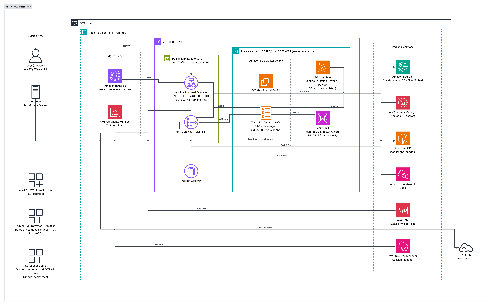

# Vela47

Vela47 is a self-hosted assistant for engineering teams that answers from the team's own documents and carries out multi-step technical work it can show and check. A typical question in operations needs two things at once: what the team's runbook says and what the vendor's documentation recommends, and often a piece of code that has to actually run. General chat assistants answer from memory, cite nothing and cannot run what they write, so every answer has to be verified by hand.

Vela47 puts two agents over one document store. The RAG agent answers questions about uploaded documents (PDF, Word, HTML, Markdown or a web page) with numbered citations to the exact passage, and says so when the documents do not cover the question. The deep agent plans a larger task and hands each step to a subagent that searches the documents and the web, or writes and tests code in an isolated sandbox, then merges the results into one answer that states what the system checked. Every stage of both agents, from how a document was cut into chunks to each model call, tool call and sandbox command, is traced live in the browser and stored with the answer.

Locally it runs on Docker in one of two ways: with its models served by Ollama on the developer's machine, or by Amazon Bedrock. On AWS it runs as three environments, dev, staging and prod, in a single account, each built from the same release by the same Terraform modules and served by Amazon Bedrock, ECS, Lambda and RDS. A release pipeline takes a change from a pull request to production.

## Demo

The demo video is not recorded yet.

<!--
When it is, replace the line above with one of these:

1. Uploaded through the GitHub editor (drag the file into README.md while editing it on github.com).
   GitHub replaces it with a link like the one below and plays it inline. Free plans accept videos up to 10 MB.

https://github.com/user-attachments/assets/<id>

2. Committed to the repository. GitHub shows it as a link, not a player.

[Watch the demo](docs/videos/vela47_demo.mp4)
-->

## Architecture

Each AWS environment lives in `eu-central-1`. Users reach it over HTTPS through Route 53 and an Application Load Balancer in the public subnets. The FastAPI application runs as an ECS task on a Graviton EC2 instance in the private subnets, next to its PostgreSQL database on RDS and the Lambda function that runs the code the agents write, which has no network access of its own. Models are called on Amazon Bedrock, secrets come from Secrets Manager, images from ECR and logs go to CloudWatch. The only way out to the internet is through NAT, used for web research.



## RAG agent

The RAG agent answers from the user's own documents and cites the passage behind every claim. It works in two phases: a document is prepared once, at upload, and every question then runs through a fixed pipeline.

<!--
Diagram of the whole agent, ingestion and answering, once drawn:

-->

**Ingestion.** A loader extracts the text of a PDF, a Word document, a web page or a text file. The semantic chunker then cuts it where the topic changes rather than at a fixed length. Every sentence is embedded, and for each gap between two sentences the windows of three sentences on either side are compared: the deeper the similarity dips below the peaks around it, the cheaper a cut there, and a cut at a paragraph break is cheaper still. Growing a chunk is cheap while a sentence stays on its topic. An A* search over the states (next sentence, start of the current chunk) then chooses all the cuts of the document together, keeping every chunk between 200 and 800 characters. Each chunk is embedded and described by its position, the headings above it, the nearest general topic and its keywords, and stored with its vector.

<!--
Diagram of ingestion and the semantic chunker, once drawn:

-->

**Answering.** Each question passes through five layers:

| Layer | What it does |
|---|---|
| Query | Rewrites a follow-up into a standalone question from the conversation, for example "how do I fix it?" into "how do I fix error E1042?" |
| Retrieval | Searches for both the question and its rewrite. Each search ranks the chunks by embedding similarity and by BM25 keyword score and fuses the two rankings by reciprocal rank; the two searches are fused again into 12 candidates |
| Security | Inspects the question for jailbreaking, and earlier answers and the candidates for poisoning |
| Reranking | The model scores every candidate from 0 to 10 in one structured call; those scoring 4 or more are kept, at most 4 |
| Generation | Streams the answer from the kept passages, citing them as `[n]`. With no passage left, it answers as a general assistant and says the answer does not come from the documents |

## Deep agent

The deep agent takes on tasks that need more than one step: research across the documents and the web, or code that has to be written and tested. It plans the work, has a specialized subagent carry out each step, and merges their reports into one answer.

<!--
Diagram of the pipeline, the subagents, their sandboxes and the A2A exchange, once drawn:

-->

| Layer | What it does |
|---|---|
| Security | Inspects the request for jailbreaking and earlier answers for poisoning |
| Planning | One structured call turns the request into at most four steps, each assigned to a type of subagent |
| Decomposition | Makes each step a task that also carries the original request |
| Subagents | Runs each task in a sandbox slot of its own, as a ReAct loop of at most six turns |
| Merging | Streams the final answer from the reports and what the system checked itself |

Each type of subagent gets only the tools its job needs, which also limits what injected text could make it do:

| Subagent | Tools |
|---|---|
| RESEARCH | search the documents, search the workspace, web search, fetch a page |
| CODE | list, read, write and edit files |
| TEST | list and read files, write tests, run tests |
| REVIEW | list, read and search files |

A model's own report is not taken on trust. After each step, probes record facts independently of the model: which files were created or changed, whether the tests pass when the system runs them again, and which pages and documents were actually read. The merged answer sees these facts next to the reports.

TEST and REVIEW can send up to two messages to the CODE subagent that wrote the code, asking it to fix what they found (agent-to-agent communication). The two subagents keep their own sandboxes, and on Docker the message travels over a network created for that exchange alone.

## AWS Well-Architected Framework

How the AWS environments address each of the six pillars.

| Pillar | How Vela47 addresses it | Services and tools |
|---|---|---|
| **Operational excellence** | All infrastructure as code, one root module per layer and environment. A release is built once and promoted unchanged: dev at once, staging and prod after an approval each. Every pull request is tested and scanned, every deployment smoke tested and recorded. Migrations keep working with the release before them. Every agent run is traced end to end. | Terraform, S3 state, GitHub Actions, Checkov, tflint, Alembic, CloudWatch Logs, ECS Exec |
| **Security** | Least-privilege IAM roles under one permissions boundary, no stored AWS keys. Application and database in private subnets, the database reachable only from the application, encrypted, with a rotated password. HTTPS only. In the application: IAM-style authorization on every request, agent code run in a sandbox with no network, private and metadata addresses refused, user messages, documents and tool results inspected for jailbreaking, poisoning and prompt injection. | IAM, GitHub OIDC, VPC, security groups, Secrets Manager, RDS encryption, ACM, Lambda |
| **Reliability** | Two availability zones. Staging and prod run two tasks and a Multi-AZ database with 14 days of backups, deletion protection and a snapshot before every deployment. Canary deployments (10% for five minutes) roll back on server errors or unhealthy tasks. Instances are replaced every 14 days, new before old. | ECS, Auto Scaling, ALB health checks, RDS Multi-AZ, CloudWatch alarms |
| **Performance efficiency** | Arm64 images on Graviton, instances sized to the tasks. Answers stream as they are written. Documents are chunked and embedded once, at upload, so a question costs one or two embeddings and the search. | Graviton, ECS capacity provider, Server-Sent Events, Bedrock |
| **Cost optimization** | dev runs only in office hours, on a NAT instance and a Single-AZ database. Models are paid per token and the sandbox per invocation, so neither costs anything idle. Any environment is removed with one workflow and rebuilt from a stored release. About $55 a month for dev and $170 for staging or prod, estimated from list prices. | EventBridge Scheduler, NAT instance, Bedrock, Lambda, Teardown workflow |
| **Sustainability** | Graviton does the same work with less energy. dev is off for about two thirds of the week, unused environments are removed rather than left idle, and the sandbox runs only while code runs. | Graviton, EventBridge Scheduler, Lambda |

## Code

About 19,000 lines of Python in 560 files, one class per file, plus a plain HTML, CSS and JavaScript interface with no build step.

### Layout

| Path | What it holds |
|---|---|
| `app/intelligence/` | The agent framework, with no knowledge of HTTP or databases: agents, models and their clients, memory and vector search, tools, sandboxes, security detectors, document loaders, web access and tracing |
| `app/server/` | The FastAPI application: routes, IAM-style security, conversation and document stores, builders that assemble the agents, configuration, the browser interface |
| `db/` | Database engines, tables and Alembic migrations. It never imports `app/` |
| `tests/` | Unit tests with fakes from `tests/fixtures/`, and live evaluations of both agents |
| `deploy/` | Terraform root modules and modules, Dockerfiles, the release definition and pipeline scripts |

### Stack

| Area | Technology |
|---|---|
| Language | Python 3.15 |
| Web server | FastAPI and Uvicorn, answers streamed as Server-Sent Events |
| Data models | Pydantic 2 for every message, configuration, request, policy and trace event |
| Database | SQLAlchemy 2 over SQLite locally and PostgreSQL (psycopg 3) on RDS, migrated with Alembic |
| Models | Ollama locally, Amazon Bedrock through boto3 on AWS |
| Authentication | PyJWT session tokens in an HttpOnly cookie, scrypt password hashes |
| Documents and web | pypdf, python-docx, httpx |
| Interface | HTML, CSS and JavaScript, with marked and DOMPurify for answers |
| Tests | pytest |

### Patterns

- **Abstract base and implementations.** Every replaceable part is an abstract base class with concrete implementations: model clients (Ollama, Bedrock), sandbox pools (Docker, Lambda, in memory), stores (SQL, in memory), chunkers, search algorithms, security detectors.
- **Factory and registry.** 23 factories build those implementations from an enum, each reading a registry kept in a file of its own, so adding one is a new class and a registry entry.
- **Pipeline over a shared context.** The deep agent, the RAG agent, the security checks of a request and the ingestion of a document each run a sequence of layers that read and write one context object. A policy object decides which layers run.
- **Dependency injection.** Builders in `app/server/builders/` assemble each agent from its model, tools, memory and sandbox pool. Nothing creates its own dependencies, so tests pass fakes instead.
- **Null object and observer.** Components always hold a tracer and report unconditionally; a null tracer stands in when nobody listens, and subscribers receive events as they happen.

### Practices

- Classes are named after what they are and files after their class; every package re-exports its contents in dependency order.
- Every Pydantic field carries a description, and records such as conversations, documents, policies and security verdicts are frozen.
- Configuration is read in one place, and every dependency version is pinned and kept up to date by Dependabot.
- About 1,600 unit tests run in five seconds without network, models or containers, using fakes rather than mocks. Live evaluations run both agents end to end, scored by objective checks and a larger model as judge.
- Pre-commit hooks and CI run the tests, Terraform formatting and validation, tflint, terraform-docs and Checkov.

## Delivery and operations

How changes reach AWS is written down as process documents in `docs/`, starting with the release process.

| Document | What it covers |
|---|---|
| [Release process](docs/release_process.md) | How a change travels from a branch to production: continuous integration on every pull request, a versioned release built once on merge, and its promotion to dev, staging and prod, with rollback, teardown and hotfixes |
| [Change management](docs/change_management.md) | What differs between the three environments, the kinds of change a release declares (infrastructure, database), the release patterns they require and who approves what |
| [Deployment order](docs/deployment_order.md) | The Terraform root modules of the account and of each environment, the order they are applied in and the reverse order they are destroyed in |
| [Dependency management](docs/dependency_management.md) | Where every dependency is pinned (packages, base images, Terraform providers, actions) and how Dependabot updates reach a release |
| [OpenID Connect](docs/open_id_connect.md) | How the workflows reach AWS without stored keys: the role they assume, its trust policy and its permissions |

## Running locally

Requirements: Docker and Terraform, plus Ollama with about 10 GB of free memory, or AWS credentials allowed to call the models on Bedrock in `eu-central-1`.

```bash
ollama pull qwen3.5:9b
ollama pull qwen3-embedding:0.6b

cd deploy/terraform/environments/local/docker
terraform init
terraform apply                              # models on Ollama
terraform apply -var model_client=bedrock    # or models on Bedrock
terraform output -raw admin_password         # password of the user admin
```

The interface is served at `http://127.0.0.1:8000/`: sign in as `admin` or continue as a guest. `terraform destroy` removes the containers and the data.

For development the server also runs directly with Python 3.15: install `requirements-dev.txt`, start `uvicorn app.server.server:app --reload`, and run the unit tests with `python -m pytest -q`.

## Known limitations

- The release pipeline and the dev, staging and prod environments are defined and checked in CI but have not been applied yet, so canary deployments are not verified live. An earlier single environment of the same stack ran on AWS. The agents are evaluated on the local models, not yet on Bedrock.
- Prompt attacks are detected by signatures, so a paraphrase or another language passes, and findings are reported, never acted on. The real containment is that each subagent only has the tools its job needs.
- Subagents within one run execute one after another, and stopping a run in the browser does not cancel it on the server.
- Vector search is brute force over the owner's chunks. That is fine within the 2 MB quota per user, not for large corpora.
- Locally the server container holds the host's Docker socket, which is equivalent to root on the host, and the sandbox containers run as root. Neither is the case on AWS.
- Web search goes through DuckDuckGo locally, which rate-limits busy addresses, and through Tavily on AWS, whose free plan allows 1,000 searches a month.
- Guest conversations and documents become unreachable when the guest's session expires and are not cleaned up.
